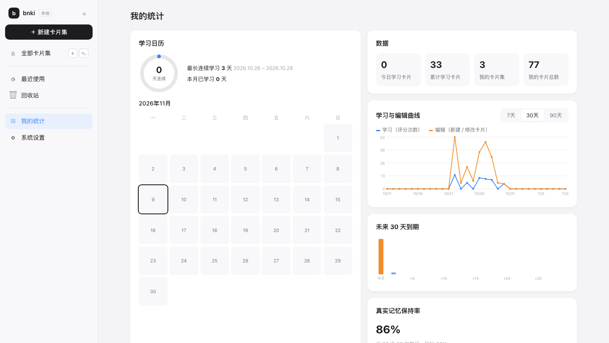
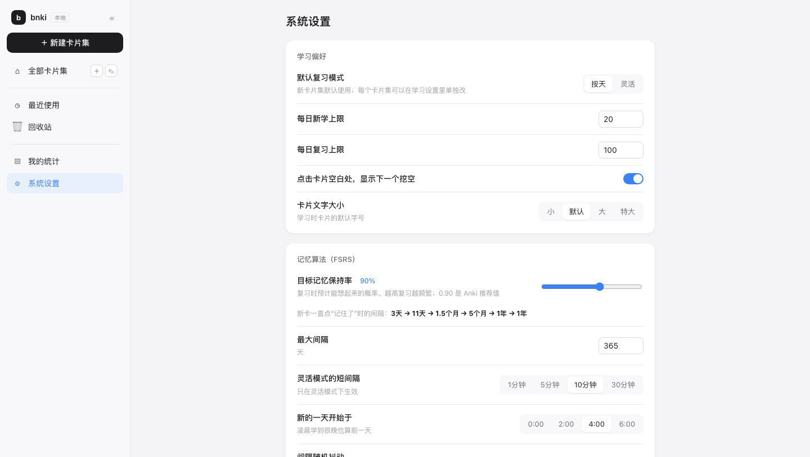
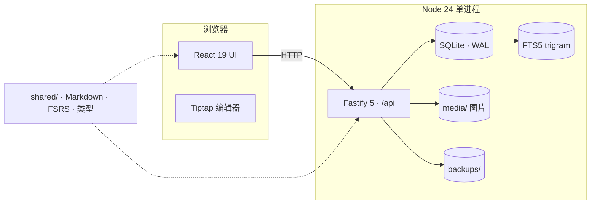

<h1 align="center">bnki</h1>

<p align="center">
  <b>本地优先的卡片复习系统</b><br>
  用 Markdown 写卡，用 FSRS 安排复习，把数据留在自己的电脑上。
</p>

<p align="center">
  
  
  
  
  
  
  
</p>

<p align="center">
  
</p>

bnki 是一个给自己用的本地卡片复习工具。界面与操作习惯参考 [氢刻](https://qingk.com)，复习调度换成 **FSRS**，数据全部落在本机 SQLite。浏览器打开一个地址就能用：没有账号、没有云同步、没有需要联网的 AI 服务。

从设计文档、HTML 原型到前后端实现、测试和浏览器逐项走查都走完了；核心功能已经可以日常使用。

---

## 为什么做

- 原工具的维护节奏慢，小功能长期不落地；想要一个自己能随时改的版本。
- 原来的复习调度是固定间隔阶梯，不看过期时长，也不看单张卡的难度。
- 卡片内容需要 Markdown，挖空、多级目录和图片是日常使用里最高频的三件事。

## 功能

**写卡 · 以 Markdown 为唯一内容格式**

- Tiptap / ProseMirror 所见即所得编辑器，同时支持 Markdown 输入规则、源码模式切换、粘贴 Markdown 自动解析。
- `{{答案}}` 行内挖空，可嵌套加粗、斜体、行内代码、高亮和公式；代码块内不解析。
- `==高亮==`、彩色马克笔、下划线、波浪线、文字颜色、KaTeX 公式、highlight.js 代码高亮。
- 自动保存（停止输入约 0.8 秒）、连续新建、格式刷、`[[` 卡片链接、粘贴图片按内容哈希去重。

**组织 · 卡片集与目录**

- 卡片集、多级目录、卡片网格；拖拽排序、框选、方向键多选、⌘A、快捷键。
- 分类、置顶、最近使用、回收站、副本、跨卡片集移动、卡片颜色。
- 卡片集内搜索与全局搜索：SQLite FTS5 trigram 索引，中文短词也能命中，结果可跳转并定位到卡片。

**复习 · FSRS 与学习页**

- 三档评分「忘记了 / 模糊 / 记住了」映射到 FSRS，按键下方实时显示本次评分后的下次间隔。
- 按天、灵活、冲刺三种模式；可调目标记忆保持率、最大间隔、学习步长、每天几点换日、间隔抖动。
- 挖空揭示（V / ⇧V / 点击空白）、问答卡提示与答案、主题卡、本轮重练、已学状态行、结束页统计。
- 系统 TTS 朗读，可设置范围、语言筛选、语速和播放模式。

**数据 · 本地与可迁移**

- 单文件 SQLite（WAL 模式）+ `media/` 图片目录；启动时每天自动备份，保留最近 14 份。
- 整库备份 / 恢复：`VACUUM INTO` 快照 + media 目录打包，恢复前自动再备份一份。
- 导入：文本 / TSV / CSV / Excel、Markdown 文件、Anki `.apkg`（Basic、Cloze、子牌组、图片）。
- 导出：Markdown、HTML、CSV、JSON；HTML 可直接打印成 PDF，挖空可保留或显示答案。
- 提供免安装 Windows 便携包脚本（Node 运行时 + 生产依赖 + 前端产物 + 双击启动器）。

## 界面

| 编辑器：Markdown、挖空与格式 | 学习：挖空揭示与 FSRS 间隔 |
| --- | --- |
|  |  |

| 统计：日历、曲线、到期预测、记忆保持率 | 设置：学习偏好与 FSRS 参数 |
| --- | --- |
|  |  |

## 技术方案



Node 进程同时提供 `web/dist` 打包页面，所以生产模式只需要一个端口。

| 层 | 选型 |
| --- | --- |
| 前端 | React 19、TypeScript（strict）、Vite、TanStack Query、Zustand、react-router-dom 7 |
| 编辑器 | Tiptap 3 / ProseMirror，自定义 cloze mark 与 Markdown 序列化 |
| 渲染 | markdown-it + 自定义插件、KaTeX、highlight.js |
| 后端 | Node 24、Fastify 5 |
| 数据 | better-sqlite3、WAL、FTS5 trigram、`VACUUM INTO` 备份 |
| 调度 | ts-fsrs（FSRS-5/6） |
| 测试 | Vitest（shared / server / web，前端 jsdom + Testing Library） |

## 工程亮点

1. **Markdown 往返一致**：卡片内容只存 Markdown，不存 Delta/HTML。编辑器 schema、自定义挖空 mark 与序列化器保证「解析 → 序列化 → 再解析」结果一致，并有往返测试兜底；前端预览、学习页、导出共用 `shared/` 的同一套解析规则。
2. **挖空是一等公民**：行内 `{{答案}}` 语法、编辑器里的加/去挖空、复习时的揭示与计数、导出时「保留挖空 / 显示答案」，从编辑到输出是一条完整链路。
3. **FSRS 落在共用层**：调度封装在 `shared/src/scheduler.ts`，前端用它算评分预览、后端用它写状态，两边不会算出不同的间隔；`now()` 可注入，测试可稳定覆盖换日、逾期、冲刺模式等边界。
4. **本地数据可靠性**：软删除 + 回收站、小数 `position` 排序让拖拽只改一行、FTS5 用 trigram 适配中文、备份恢复时替换数据库连接（`ctx.reopen`）避免读到旧句柄。
5. **验证不靠手点**：39 个测试文件、317 个测试覆盖 shared / server / web；另有 `docs/e2e-walkthrough.md` 记录在真实浏览器里逐项操作 P0 + P1 功能的结果，包括导入导出、备份恢复、朗读发声、窄屏和原型对照。

## 快速开始

需要 Node 24。

```sh
npm install
npm run dev        # 开发：后端 18420 + 前端 18421，打开 http://127.0.0.1:18421
npm run build      # 构建前端到 web/dist
npm start          # 生产：一个进程同时提供接口和页面，http://127.0.0.1:18420
```

本项目占用 18420–18429：

| 端口 | 用途 |
| --- | --- |
| 18420 | 后端（`npm start` 时也提供页面） |
| 18421 | 前端开发服务器（Vite，代理 `/api`、`/media` 到 18420） |
| 18429 | 原型预览（`python3 -m http.server 18429 -d prototype`） |

后端命令行参数：`--port`（默认 18420）、`--host`（默认 127.0.0.1）、`--data`（数据目录）、`--web`（前端构建目录）。

数据目录里有 `bnki.sqlite`、`media/`（图片）、`backups/`（每天第一次启动时自动备份，保留 14 份）。

## 目录结构

```
bnki/
├─ shared/        # 前后端共用：Markdown 解析、挖空规则、FSRS 封装、类型与常量
├─ server/        # Fastify API、SQLite、导入导出、备份、搜索、Anki 解析
├─ web/           # React 前端、Tiptap 编辑器、学习页、统计与设置
├─ prototype/     # 设计阶段的 HTML 原型（界面与交互的参照）
├─ docs/          # 设计文档、接口约定、浏览器端到端走查记录
├─ scripts/       # macOS LaunchAgent、Windows 便携包脚本
└─ data/          # 运行时数据：SQLite、media、backups（不进版本库）
```

## 测试与检查

```sh
npm test           # 39 个测试文件 / 317 个测试
npm run typecheck  # shared、server、web 三个包的 strict 类型检查
```

## 部署

<details>
<summary><b>macOS：登录后自动启动</b></summary>

用 LaunchAgent 在登录时启动后端（`npm start` 同一套参数），只起服务、不打开浏览器；进程崩了会被 launchd 重新拉起。

```sh
# 安装（plist 里是绝对路径，换机器或换 node 路径要改）
cp scripts/dev.kris.bnki.plist ~/Library/LaunchAgents/
launchctl bootstrap gui/$(id -u) ~/Library/LaunchAgents/dev.kris.bnki.plist

# 临时停掉（要用 npm run dev 前先执行，否则 18420 被占用）
launchctl bootout gui/$(id -u)/dev.kris.bnki
# 开发完再挂回去
launchctl bootstrap gui/$(id -u) ~/Library/LaunchAgents/dev.kris.bnki.plist

# 改了后端代码后重启服务；改了前端要先 npm run build
launchctl kickstart -k gui/$(id -u)/dev.kris.bnki

# 看状态和日志
launchctl print gui/$(id -u)/dev.kris.bnki
tail -f ~/Library/Logs/bnki/server.log

# 彻底卸载
launchctl bootout gui/$(id -u)/dev.kris.bnki
rm ~/Library/LaunchAgents/dev.kris.bnki.plist
```

</details>

<details>
<summary><b>Windows：免安装便携包</b></summary>

```sh
node scripts/package-windows.mjs
# 产物：dist-windows/bnki-windows.zip
```

脚本会构建前端、复制运行所需源码与生产依赖、下载对应版本的 `node.exe`，并生成双击启动器。解压后即可运行，不需要安装 Node。

</details>

## 范围与后续

优先级按 P0（日常使用必需）、P1（第一批增强）、P2（暂缓）划分。

- 范围：桌面浏览器、单用户、纯本地；不做移动端、账号与云同步。
- 已完成：设计文档、HTML 原型、P0 全部功能、P1（Anki / Markdown 导入、导出、导图、朗读、卡片链接、格式刷、字号、全文搜索等）。
- 暂未实现（P2）：AI 生成卡片集与测验、AI 自动挖空 / 提示、录音与附件、用复习日志训练 FSRS 参数。

设计文档与原型在 [`docs/design.md`](docs/design.md) 和 [`prototype/index.html`](prototype/index.html)；接口约定在 [`docs/contracts.md`](docs/contracts.md)。

---

<p align="center">
  <sub>个人项目 · 作者 <a href="https://github.com/lijian1999">@lijian1999</a> · 2026</sub>
</p>
